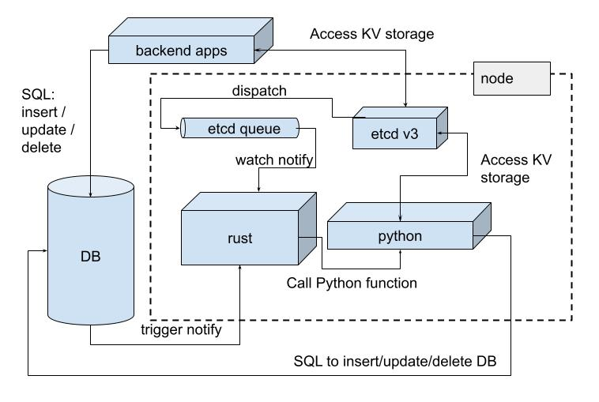

# RPPD - Rust Python Postgres Discovery

## Top features:

- Etcd integration with either Rust implementation for message queue and valilla impl for topic notify
- Cluster/Cloud oriented for horizontal scalling
- Lightwight (but still with std lib)
- Simple cofiguration
- Protobuf with gRPC
- Embeddable to use as lib in your project
- i18n for message translation


## Build

> [!NOTE]
https://grpc.io/docs/protoc-installation/


### Build
To build the project requirements
```shell
git clone https://github.com/lupko/etcd3-client.git
cd etcd3-client
pip install .
pip install typing-extensions
```


### FAQ
> [!NOTE]
reinstall

IF
> Mismatched rust versions: cargo-pgrx Mismatched rust versions: cargo-pgrx

Then (this takes time)
```shell
cargo install cargo-pgrx --force && cargo pgrx 
# would require clang, gcc, libc6-dev, protobuf-compiler, libicu-dev, icu-devtools, libreadline-dev, build-essential, flex and bison installed
# cargo install protobuf-codegen
 
```
## C version of Postgres extension
If you need C version of Postgres extension, please check
[Readme C version](rppd-pg-c)


## Overall architecture

- Postgres extension with a trigger to notify backend service about a insert or update or delete event.
- The service is a one to many instances with first act as master and run or forward event execution to the actor nodes.
- All nodes tried to register on master and participate in performance.
- Function trigger created on a target table and relay on topic/queue definition. This might be a column to pass a row id into function.
- The executed code is a python function. 
- The action also available by schedule to implement a cron job. Only the master runs the jobs; the other nodes keep their schedules moving, so a new master does not fire the jobs it missed.
- All configuration store in db table created by extension.
- If main service shutting down of unavailable than one ot service become a master. 
- No cluster leader election, but whoever be able to safe and undoubted updated self as master on configuration table. 




## Usage

1. Create postgres extension: copy rppd.so and create few tables in desired schema
 > create extension 
 > cp -f target/debug/librppd.so /usr/lib/postgresql/14/lib/rppd.so

2. Run as many service as required:
 - a text file in any format OR a dir with a file: rppd.rppd_config names are: 'schema', 'url', 'bind'
 - three optional args, in any order: config schema, db connection url (starts with 'postgres://', binding IP and port default is 'localhost:8881'
 - use PGPASSWORD env variable (or from file) to postgres connection
 - use PGUSER env variable (or read from file) to postgres connection
 - priority is: env (if used), if no use or not set, than app args param, than file, than default 
3. Perform insert or update to configure a callback AND fire a function


> [!NOTE]
Use select the row by ID on INSERT trigger would fail because requested row might not visibly yet depends on transaction isolation. 
The simple workaround is to sleep a second on Python function call.

 

### Use to get more build in help:
```sql
psql> \dx rppd
psql> \df+ rppd*
```

## Python samples

### variables - kwargs

```python 
DB -- database connection
TOPIC -- fc.fns.topic
TABLE -- fc.fns.schema_table
TRIG -- UPDATE = 0;  INSERT = 1;  DELETE = 2;  TRUNCATE = 3;
"COLUMN_NAME" --i.e. "ID" = see trig_value
ETCD -- The etcd client
DF -- Apache DataFusion (aka Ballista) client, see below
CH -- ClickHouse client (clickhouse_connect), see below
```

### ClickHouse client `CH`

Set `ch_url` (or, under yt-cluster, the node's `serve_clickhouse` + `clickhouse_url`
config rows) to expose a `clickhouse_connect` client to every function as `CH`,
alongside `DB`. Requires the python `clickhouse_connect` package; a missing
package or a refused connection is logged and simply leaves `CH` unbound.

```python
CH.command("CREATE TABLE IF NOT EXISTS analytics.t (id Int32) ENGINE = MergeTree ORDER BY id")
CH.insert('analytics.t', [[1]], column_names=['id'])
```

A worked example that joins a PostgreSQL row with live cluster status and lands
both in ClickHouse is in `examples/` (`fn2_queue_to_clickhouse.py`).

### Secrets `SECRET`

Embedded in a YT Cluster node (ytserv with `skv_secrets` on), a function reads
values from the cluster's secret store - never from a table, never from etcd:

```python
token = SECRET.get("api_token")          # str
blob = SECRET.get_bytes("tls_key")       # bytes
SECRET.names()                           # what this function may open
```

`SECRET` exists only for a function whose `rppd_function.secret_names` lists
names (commas or spaces), and opens only those - another name raises
`PermissionError`. `secret_names` holds names, never values. **Whoever may write
`rppd_function` decides which function reads which secret**: the table
replicates, so its GRANTs are the boundary. The value is opened in the node's
memory with the cluster master key and goes into this interpreter only - not to
`rppd_function_log`, not to the database. See ytserv/skv-secrets.md in yt-pgxt.

### python example:
```python

sql = "SELECT * FROM {} where a = %s".format(TABLE)
print(sql)

cur = DB.cursor()
cur.execute(sql, (PK))
print(cur.fetchall())

cur.execute("insert into test (b) values (%s)", ( "{}-{}".format(TOPIC, TRIG),))
DB.commit()
```


### test example:
```sql
create table if not exists test_source (id serial primary key, input text);
create table if not exists test_sink (id serial primary key, data text);
\set code `cat test_fn.py`
insert into rppd_function (code, checksum, schema_table, topic, verbose_debug, cleanup_logs_min) values (:'code', 'na', 'public.test_source', '.id', true, 100);
CREATE TRIGGER test_src_event AFTER INSERT OR UPDATE OR DELETE ON test_source FOR EACH ROW EXECUTE PROCEDURE rppd_event();
insert into test_source (input) values ('test input');
select * from test_sink;
```

### python test example
for the test above
```python
cur = DB.cursor()
cur.execute("SELECT input FROM test_source where id = %s", ([ID]))
input = cur.fetchall()
if len(input) > 0:
    cur.execute("insert into test_sink (data) values (%s)", ( input[0] ))
    DB.commit()
```

### etcd test example:
```sql
\set code `cat test_fn_etcd.py`
insert into rppd_function (code, checksum, schema_table, topic, verbose_debug, cleanup_logs_min) values (:'code', 'na', '/q/test', '', true, 100);
```

run
```python
import etcd3
ETCD = etcd3.client("localhost", 8881)
ETCD.put('/q/test/producer/111', 'test kv to etcd queue')
```

check
```sql
select * from test_sink where data like '/q/%';
```

### DataFusion / Ballista client

Requires building rppd with the `datafusion` cargo feature and the python `ballista` package (`pip install ballista`) available.
Configure the scheduler address as `df_url` in the library config (a text/file config key `df`, a `df://host:port` app arg, or `RppdConfig.df_url` when used as an embedded library) -- see [Ballista Python quickstart](https://datafusion.apache.org/ballista/user-guide/python/quickstart.html).
When configured, every python function gets a ready-to-use `DF` variable (a `BallistaSessionContext`); when not configured, `DF` is simply not injected.

```python
df = DF.sql("SELECT * FROM t LIMIT 5")
df.show()
```


## Cadence: a watch on a pipeline process

A pipeline process (pp) that feeds an etcd queue is expected to produce messages
on a cadence. A row of `rppd_cron` with `cadence = true` watches it instead of
scheduling a job:

| column | on a cadence row |
|---|---|
| `fn_id` | the function consuming the pp queue - its `schema_table`, a `/q/` path, is the queue watched |
| `cron` | the expected cadence: a message is due by the end of the first full cron period after the last one seen (`*/5 * * * *`: a message at 12:01 is due by 12:10; `0 9-17 * * 1-5`: hourly, business hours only) |
| `watch_min` | minutes on watch before the deadline; 0 sends the deadline message at once |
| `retry_sec` | the watch message repeats this often while on watch; 0 sends it once |
| `watch_q`, `deadline_q` | the `/q/` queues the messages go to; null sends none |
| `state`, `last_seen`, `since`, `attempt` | kept by rppd: `ok`, `watch` or `deadline` |

A missed cadence puts the pp on `watch` with a message to `watch_q`, repeated
every `retry_sec`; after `watch_min` it goes to `deadline` with ONE message to
`deadline_q`; the next message on the pp queue brings it back to `ok` with an
`ok` message to the queue of the state it left. What the messages trigger - a
wait, an email, a self-healing API call, an escalation - is up to whatever
consumes those queues (an rppd function, or any etcd client). The messages are
JSON on producer keys `<q>/producer/<pp id>-<epoch ms>`:

```json
{"pp": 3, "queue": "/q/orders", "fn_id": 7, "state": "watch", "due_at": "...", "last_seen": "...", "late_sec": 42, "attempt": 1}
{"pp": 3, "queue": "/q/orders", "fn_id": 7, "state": "ok", "was": "deadline", "down_sec": 960, "last_seen": "..."}
```

The watcher of whichever node consumes the queue notes each arrival (written to
the row at most every 5 s); the master evaluates every 5 s, and the state lives
in the row, so a new master continues. With the consuming function on several
nodes of a YT Cluster, `rppd_cron` must be a synced table for their arrivals
to reach the master. A row whose function does not consume a `/q/` queue, or
whose cron does not parse, gets `error_msg` and is not evaluated. An existing
`rppd_cron` gets the new columns from rppd at startup (see "Schema" below);
without them cron runs and cadence stays off.

## Circuit breaker: a pipeline process that keeps failing

A function whose calls keep failing (its downstream is down) is held instead of
called again and again, and its events wait instead of being lost. Per function,
on each node that runs it, with these `rppd_function` columns:

| column | default | |
|---|---|---|
| `breaker_fails` | 0 | failures in a row that open the breaker; 0 = no breaker |
| `breaker_slow_ms` | 0 | a call slower than this counts as a failure; 0 = off |
| `breaker_open_sec`, `breaker_open_max_sec` | 30, 900 | how long it stays open before one probe; doubles per re-open, up to the max |
| `max_attempts` | 0 | attempts per event; 0 = no retry (the error is recorded and the event is done) |
| `notify_q` | null | a `/q/` queue for the breaker's transitions |
| `dlq` | null | a `/q/` queue for events that failed `max_attempts` times |

`breaker_fails` failures in a row open the breaker: the function's events are
held (an etcd message stays unacknowledged, a logged trigger event keeps
`took_ms` null - a restart has both again) and the other functions keep
running. After `breaker_open_sec` one event goes through as a probe; if it
succeeds the breaker closes and the held events run, if it fails it opens again
for twice as long. An `UPDATE` of the function's `code` - the fix - probes at
once instead of after the back-off. With `max_attempts` a failed event goes back
to the head of its line and is retried when the breaker lets events through;
after the last attempt it goes to `dlq` and only then is its message
acknowledged. That is at-least-once delivery: **a function with retries must be
idempotent.**

Transitions go to `notify_q` as JSON on producer keys, the cadence format, and
to the node's own row of `rppd_function_state` (`state`, `since`, `attempt`,
`last_error`, `held`), read back on a restart - an open breaker stays open
until its back-off ends:

```json
{"pp": 7, "kind": "breaker", "state": "open", "node": 2, "fails": 3, "error": "ConnectionRefused: crm:443", "attempt": 1, "retry_at": "..."}
{"pp": 7, "kind": "breaker", "state": "closed", "node": 2, "down_sec": 184, "held": 52}
{"pp": 7, "kind": "dead", "node": 2, "key": "/q/orders/producer/991", "value": "...", "error": "...", "attempts": 5}
```

## Traffic shaper: how many calls of a function, how often

Per function, on each node, with these `rppd_function` columns:

| column | default | |
|---|---|---|
| `max_parallel` | 0 | the ceiling of the adaptive limit: calls of the function running at once on a node; 0 = no shaping |
| `min_parallel` | 1 | the floor the limit never goes under |
| `target_ms` | 0 | the latency the limit steers by; 0 = learned (twice the 10th percentile of the last 100 calls) |
| `rate_per_sec`, `burst` | 0, 1 | a hard cap of calls per second on top of the limit (a token bucket); 0 = none |
| `max_backlog` | 0 | waiting calls over this send one backlog notice; 0 = none |

The limit adapts to the function's own latency - its downstream's, as the
function sees it: a failure halves it, a call slower than the target takes 10%
off (each at most once per round of calls in flight, so one slow outlier costs
10%, not half), and a call within the target with the limit in use adds `1/L`,
back up to `max_parallel`. A call that may not start waits in the shaper, in
order, and the other functions keep running. At the floor for 100 calls it
sends one `throttled` notice to `notify_q`, and `recovered` once above it; the
limit is written to the node's `rppd_function_state.limit_now` at most every 5 s.

```json
{"pp": 7, "kind": "throttled", "node": 2, "limit": 1, "target_ms": 800, "took_ms_p50": 2400}
{"pp": 7, "kind": "backlog", "state": "over", "node": 2, "backlog": 5000}
```

## Tracing

Embedded in a YT Cluster with OpenTelemetry on, a function's call is a span
in the trace of what fired it: for a table with `on_commit_python`, the
committing cluster transaction's trace (its `yt.tx` root on the origin). The
function sees its own span as `TRACE`, a W3C `traceparent` string, to continue
the trace in its own spans or in an outgoing call's header:

```python
import requests
requests.post(url, json=row, headers={"traceparent": TRACE} if 'TRACE' in dir() else {})
```

## Schema

`rppd.yaml` is the one definition of rppd's tables. At startup rppd applies it
to an existing install (one that has `rppd_function`) with SchemaGuard: missing
columns and tables are added, nothing is dropped, triggers are left to the
extension, and a difference that would need something destroyed is skipped.
There is no hand-written `CREATE` or `ALTER` in rppd.

## TODO - features and improvements 
- Connect to multiple DB (rw/ro - replica)
- OpenTelemetry integration
- Python function code sign, approve and verify on call
- Keyvault (secret) integration for a Database connections


## End-to-end tests

rppd runs inside the YT Cluster's ytserv, and is tested there, from the
yt-cluster-tests repository (DBinvent/yt-cluster) next to this one:

- `yt-cluster-tests/topology/92_rppd.sh` - Python server functions triggered by a
  cluster commit, on a seven-node docker cluster;
- `yt-cluster-tests/pipeline/` - the on-commit chain into etcd queues and ClickHouse.

`yt-cluster-tests/nightly/nightly.sh` runs them every night this repository (or
another watched one) changed; see yt-cluster-tests/README.md.
